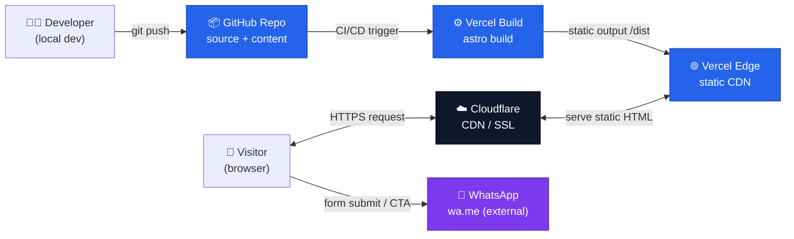
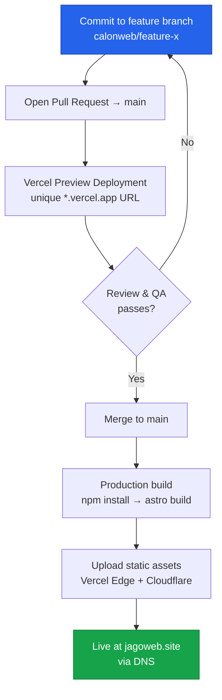
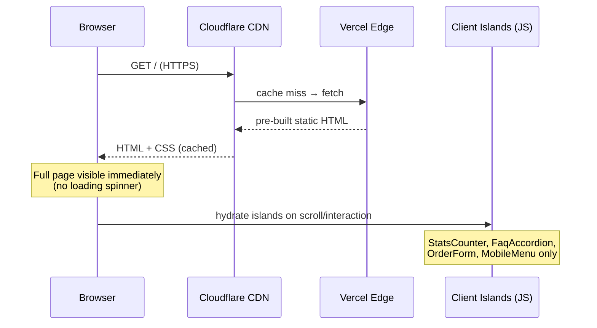
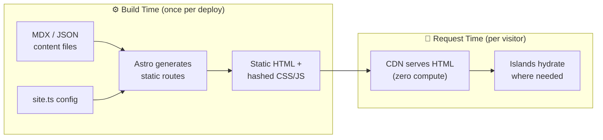
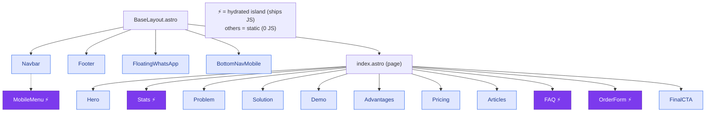
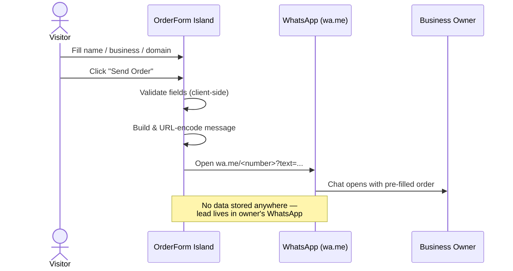
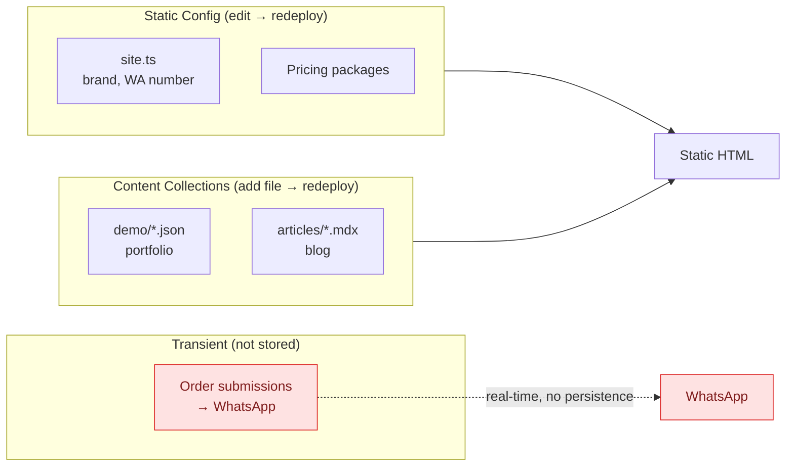
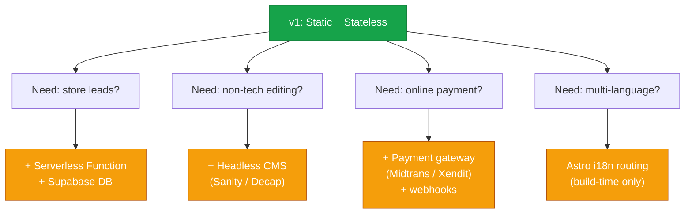

# System Design Diagrams

Visual companion to [`PRD.md`](./PRD.md). All diagrams use Mermaid and render
natively on GitHub. They describe a **static-first (JAMstack)** architecture with
no backend or database of our own.

---

## 1. High-Level System Architecture

> **No application server, no runtime database.** Everything is pre-rendered at
> build time and served from a CDN. Orders are delegated to WhatsApp.

---

## 2. Build & Deployment Pipeline

| Environment | Trigger | URL | Purpose |
|---|---|---|---|
| Local | `npm run dev` | localhost:4321 | Development |
| Preview | PR opened/updated | `*-preview.vercel.app` | QA / review |
| Production | merge to `main` | jagoweb.site | Live |

---

## 3. Request Lifecycle & Rendering

**Build-time vs request-time split:**

---

## 4. Component & Island Architecture

**Hydration directives:**
- `client:visible` → `Stats`, `FAQ` (hydrate when scrolled into view)
- `client:load` → `MobileMenu`, `OrderForm` (ready on interaction)

---

## 5. Order Flow (No Backend)

---

## 6. Data Classification

> **No write path** exists into the system. Every content change is a Git commit
> that triggers a rebuild — keeping the attack surface minimal and hosting free.

---

## 7. Future Scalability Paths (v2+, not in v1)

**Design principle:** keep v1 static and stateless; add infrastructure only when a
concrete requirement justifies it.

---

*See [`PRD.md`](./PRD.md) §16–§23 for the written explanation behind each diagram.*
